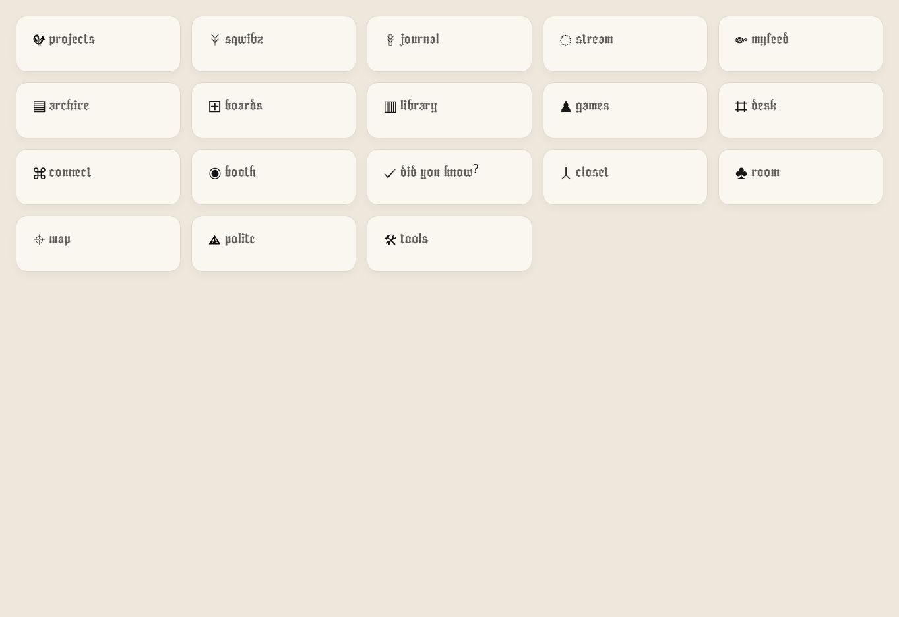

# Widget header alignment — rule and verification

October 21, 2026. Requested correction: uniform visible symbol proportions and alignment with the following title; both reduced by 25%.

## Why the previous fixes were insufficient

1. A CSS box is not the visible artwork. The PNG files have different transparent margins. Centering equally sized images centers their canvases, which can leave the drawn marks off-center and at different apparent sizes.
2. Text also has invisible space. Centering a title's line box does not center the visible letters. The stitched font's ascent, descent and actual glyph bounds differ.
3. Some headers had shared rows; others used older inline layouts. More-specific per-widget rules and later hydration could reintroduce dimensions and vertical shifts.
4. Previous DOM tests established dimensions and structure, not rendered optical alignment. They were insufficient evidence for claiming the visual result was aligned.

## The rule

| Property | Previous target | New target (75%) |
|---|---:|---:|
| Invisible symbol slot | 28 × 28 px | 21 × 21 px |
| Maximum visible artwork dimension | 24 px | 18 px |
| Title font size | 27 px | 20.25 px |
| Symbol-slot to title gap | 6 px | 4.5 px |

The square is a layout guide, not a visible border. The symbol's longest visible dimension is 18px; the other dimension follows its original aspect ratio. A wide swirl is necessarily shorter than a tall ankh. Equal apparent size does not mean stretching every drawing to occupy an 18×18 square.

For images, the implementation measures nontransparent pixels (alpha > 16), computes their bounding rectangle, and applies one uniform scale:

`scale = 18 / max(visibleWidth, visibleHeight)`

The image position centers that visible rectangle inside the 21px slot. Original artwork files are unchanged. Inline SVGs use their actual drawing bounds; text symbols are rendered in proportional SVG view boxes measured from the glyph. Archive's intended rotation is retained.

Titles use the same loaded font and baseline correction. Canvas font metrics for the reference word “projects” calculate the difference between the line-box center and the visible-letter center. The same offset is applied to every title using that font, rather than shifting different words independently. In the browser specimen, the stitched font produced a −1px title correction. The title box therefore sits 1px above the slot center intentionally: the *visible lettering* is the alignment target.

Newly inserted headers, late-loaded symbols and font completion trigger the same rule. Header-only inline geometry is stripped when artwork is copied into the sidebar so the toolbar does not inherit absolute positioning.

## Browser evidence

The public, noindex specimen at https://biglwa.com/qa/widget-headers.html contains source-derived header markup and the production styles, font and alignment module. It contains no user account data.

The first Chrome inspection covered these 15 headers: Projects, Sqwibz, Journal, Stream, myfeed, Archive, Boards, Library, Games, Desk, Connect, Booth, Did You Know, Closet and Room. Every one measured:

- 21×21px symbol slot;
- 20.25px title font;
- 4.5px gap;
- −1px reference-font correction.

Measured visible image dimensions in that inspection:

| Symbol | Visible width × height |
|---|---:|
| Projects | 18.00 × 16.70 px |
| Sqwibz | 11.16 × 18.00 px |
| Journal | 9.30 × 18.00 px |
| myfeed | 18.00 × 9.09 px |
| Did You Know | 18.00 × 14.00 px |
| Closet | 13.19 × 18.00 px |

Map, Politic and Tools have also been added from their late-widget source markup to the specimen for the final inspection.

## Scope and limits

This rule covers Studio widget symbol/title pairs (`.card-icon` beside an h2/h3), including dynamically inserted pairs. It does not shrink body text, navigation controls, profile names, or headings inside full module pages. The specimen verifies the production header rendering in isolation; it is not a claim that the signed-in user's entire customized Studio has been visually inspected.

The existing full-shell toolbar/Skeleton Keys runtime test, route/build integrity tests and deployment gates remain in use. Browser observation supplies the visual evidence those DOM tests lacked.

## Final rendered inspection

After the final deployment, Chrome was reloaded and all **18 headers** were inspected together: the original 15 plus Map, Politic and Tools. All 18 retained the same slot, font size, gap and −1px font correction. Archive's horizontal mark was visibly preserved. Politic's measured visible artwork is 18.00×13.17px.

The screenshot below is an actual browser capture, not a generated mockup. The accompanying JSON records the measured DOM values for every header. This verifies the specimen at the captured desktop viewport; it does not claim an authenticated account screenshot or an exhaustive device matrix.

Measurements: [header-metrics-20261021.json](header-metrics-20261021.json).
