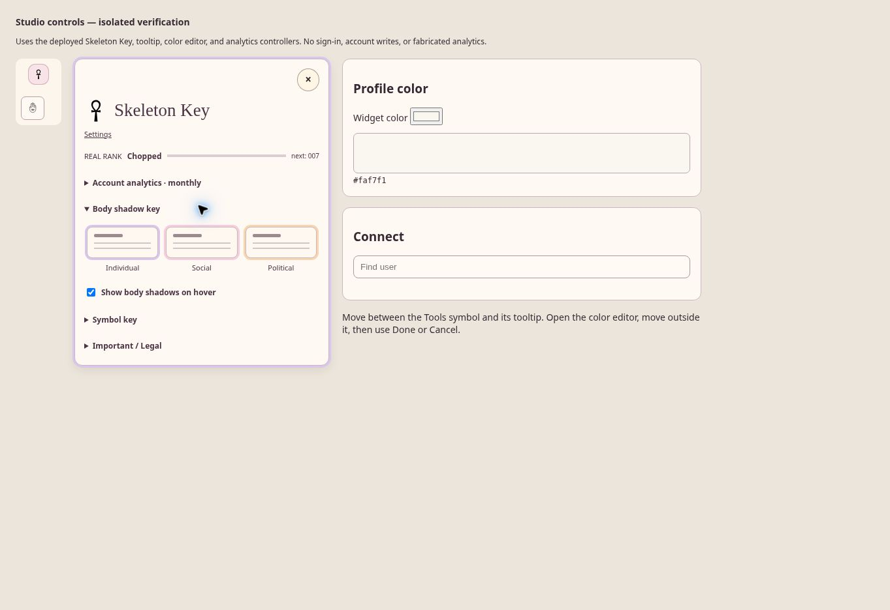
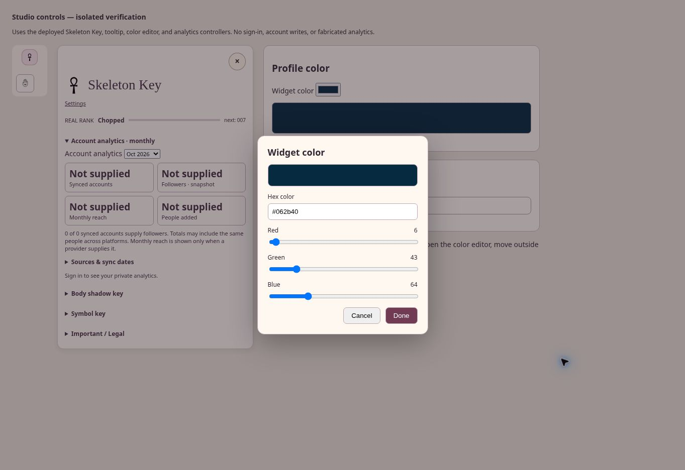
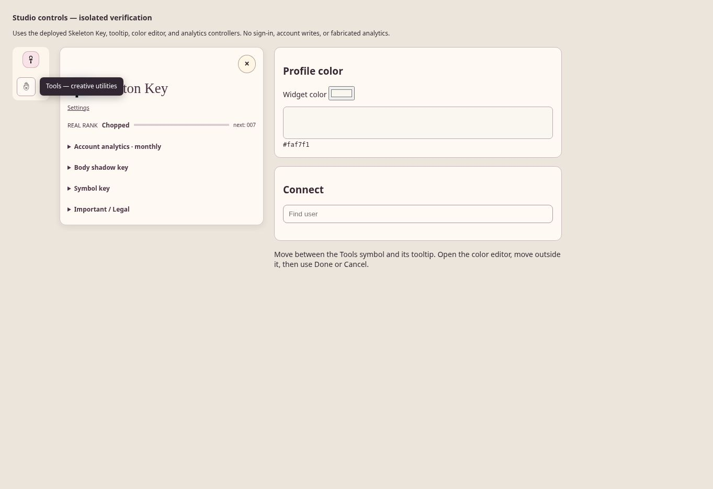

# Skeleton Key, stable controls, and initial account analytics

Implementation commit: c7ce2d5857a85d4dbafca01d631ca1b7c842f037.

## Changes

- Removed the standalone All / Individual / Social / Political strip and individual widget body badges. Existing hover shadows remain enabled by default.
- Skeleton Key now has a compact title and Settings link, Real Rank, and mutually exclusive expandable sections for monthly analytics, the body shadow key, symbols, and Important / Legal. Rights lives in the legal section and is excluded from toolbar shortcuts. Removed the Site tour button.
- The body key shows three miniature widget cards with the same Individual, Social, and Political shadow colors used on real widgets. Its checkbox controls those hover shadows.
- Toolbar artwork now selects a single image or SVG leaf instead of copying nested icon wrappers. Tools uses the hand-and-eye SVG based on the supplied reference. Existing optical sizing and shortcut behavior are preserved.
- Help text stays visible while moving between a control, its icon/text children, and the tooltip. Moving away gets a 220ms grace period; Escape dismisses it.
- Profile color inputs open an explicit color editor with hex and RGB controls. Pointer exit and backdrop clicks do not discard it. Done accepts the draft; Cancel/Escape restores the original input value. Existing appearance input/change handlers receive the updates.
- Connect has Find user search against the existing username directory. Adding a person records a private connection on the signed-in owner's user record; it does not send an invitation or message. The username prefix search terminator was corrected.

## Analytics scope

The implementation reads stored provider connection records, shows follower counts where supplied, counts people added separately from linked service accounts, and records a private observation for the current calendar month while the application is used. A month selector shows saved observations. There is no invented historical backfill or unattended monthly synchronization.

Monthly reach requires a provider value explicitly marked as reach for that month. Existing integrations do not currently supply it; the UI shows Not supplied. Followers across services can overlap and are not presented as unique people. Provider sync dates and coverage are visible. Missing values remain unknown, while a reported zero remains zero.

Real Rank has moved into Skeleton Key. A saved rank label is used when available; the existing starting rank remains otherwise. No new ranking formula or inferred engagement score was fabricated.

## Verification

- All 69 existing Pages workflow source/behavior checks passed locally.
- Production toolbar DOM test passed: original green/red docking and restoration, yellow/red shortcut dragging, saved shortcuts, banner connections, account-state reload, and delayed recovery.
- New controller DOM test passed: pointer transitions, tooltip persistence, color draft/Done/Cancel, missing vs zero metrics, month-qualified reach, owner isolation, Find user, and adding a person.
- GitHub tree exactly matched the locally tested tree before publication.

## Deployment and Chrome proof

- Initial Pages run 39681428534 succeeded for c7ce2d5857a85d4dbafca01d631ca1b7c842f037.
- Browser verification found one additional focus-loss case when clicking a tooltip. Follow-up commit 226baac4a95e6f514b33bde472a1781e16f190dc fixes it and adds a regression assertion. Pages run 39681887974 succeeded.
- Verified https://biglwa.com/qa/studio-controls.html loads persistent-interaction version 20261021-persistent-2.
- Default panel height: 340.6875px in the verification viewport. Exactly one Tools image; no body-filter strip or body badges; Real Rank resides in skeletonRankMount.
- Opening monthly analytics closes the body shadow section, keeping only one main section expanded.
- Color browser check: entered #062b40, moved the pointer outside and clicked the backdrop. Dialog remained open and input retained #062b40. Done closed and accepted it. Reopened, changed to #ffffff, then Cancel restored #062b40.
- Tooltip browser check: clicking Tools showed help; moving into and clicking the help bubble left it visible after focus moved. Escape dismissed it. This was retested after the follow-up deployment.

Screenshots:

These are isolated verification pages running the deployed production controllers, not a signed-in Studio session. The browser displayed the site's sign-in page when visiting the main app. Authenticated Firebase writes, real user search results, provider totals, and saving profile settings to a live account remain unverified in-browser. DOM tests use account fixtures and are identified as such.
